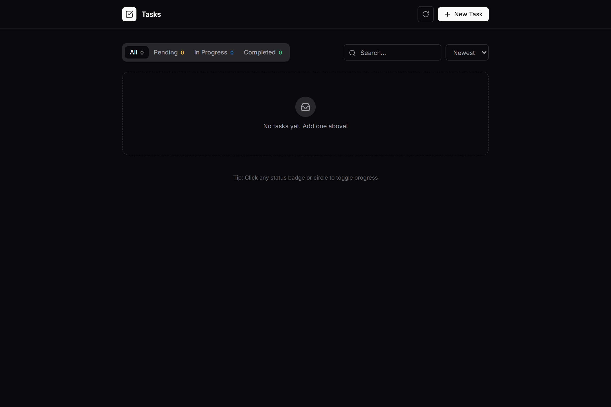
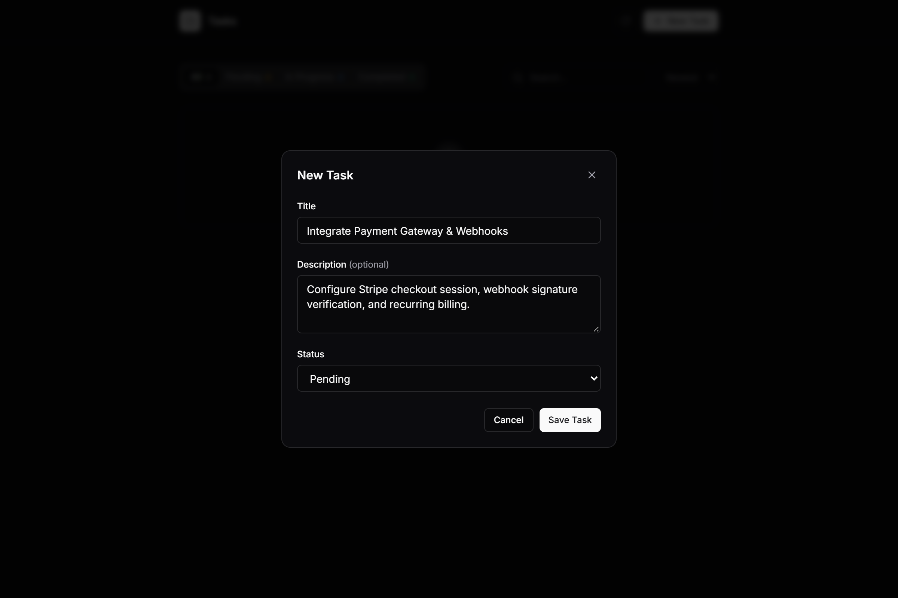
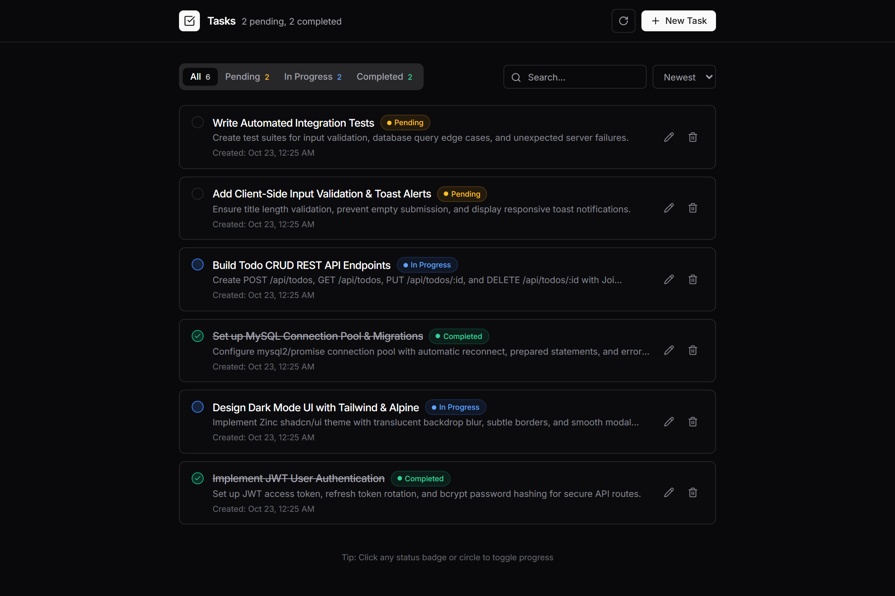
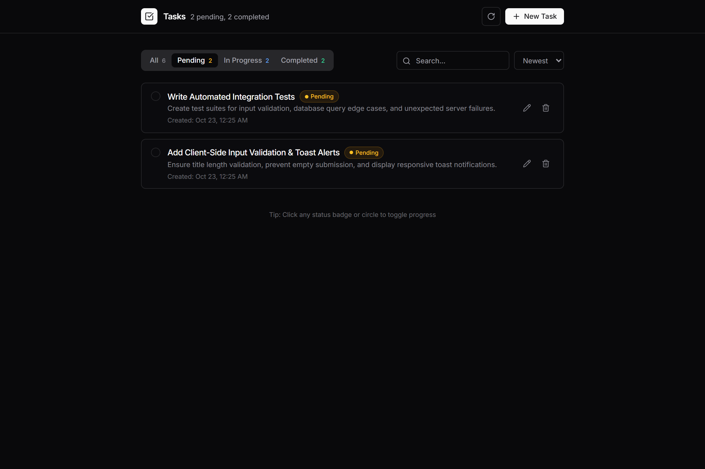
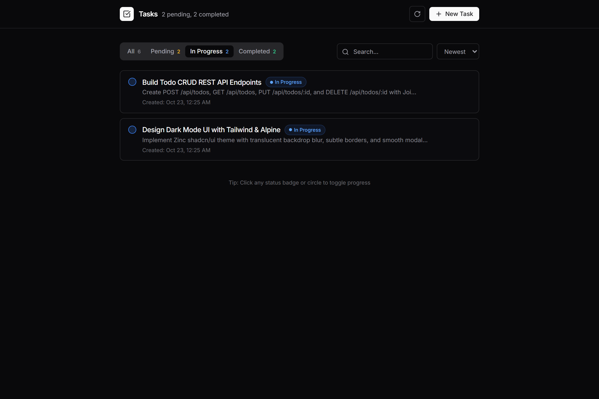
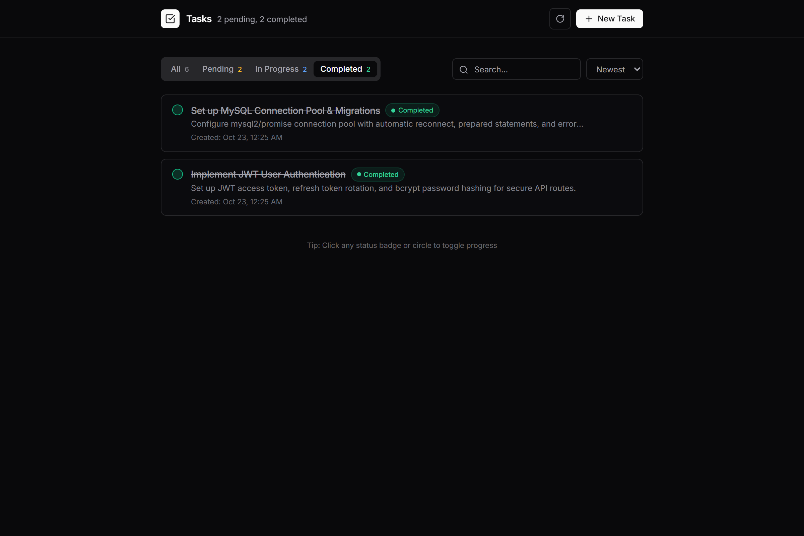
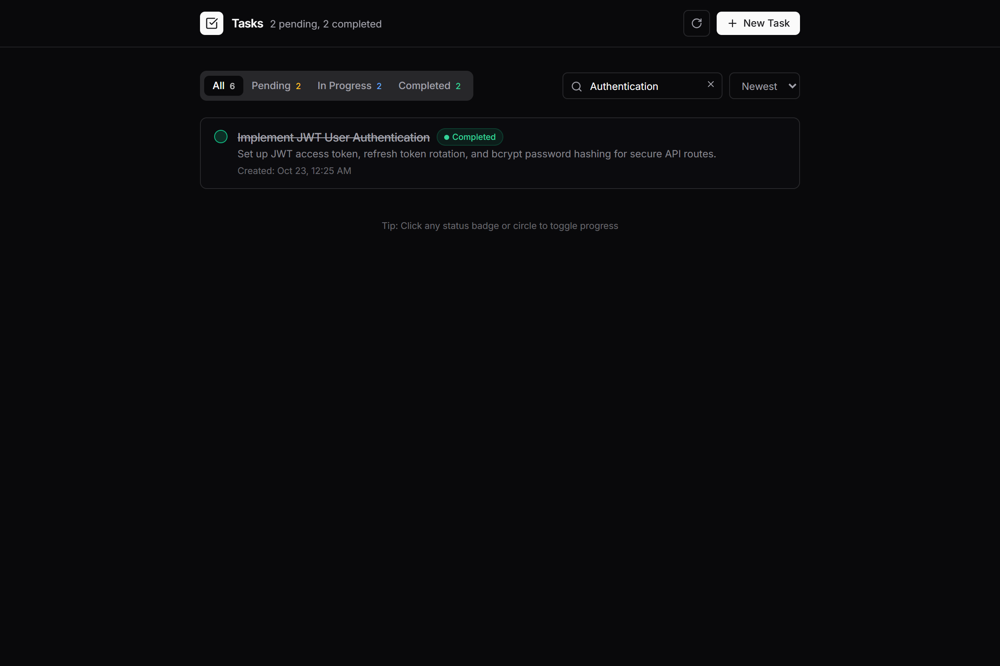
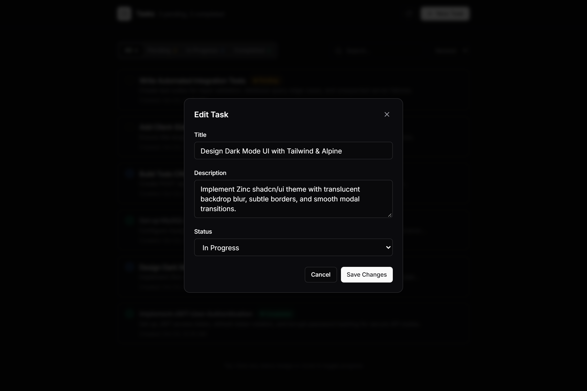
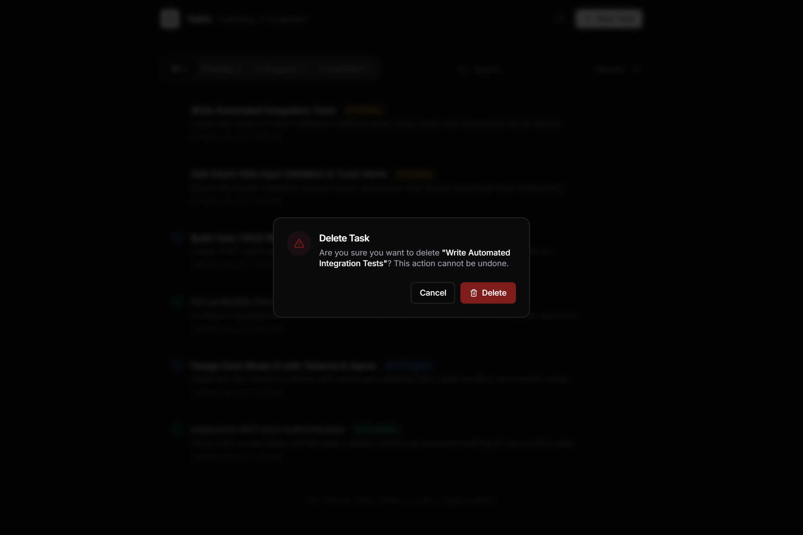
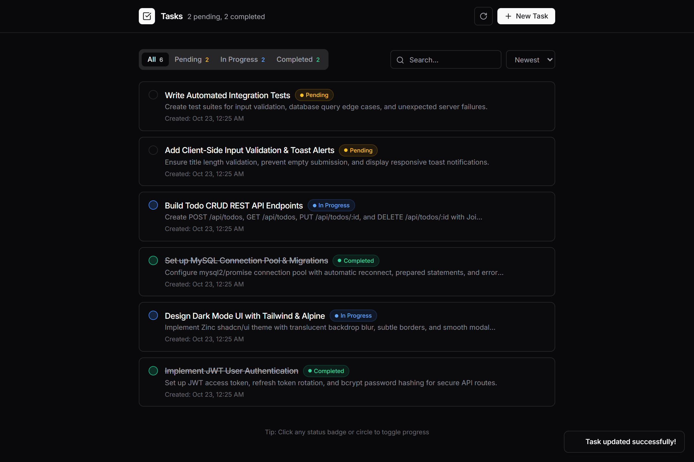

# Todo App — Full-Stack Node.js & MySQL Application

A production-grade, full-stack task management application built with Node.js, Express 5, MySQL, and a reactive frontend using EJS, Tailwind CSS (Zinc theme), and Alpine.js.

The project implements a clean Model-View-Controller (MVC) architecture, parameterized SQL statements for injection prevention, client-side draft persistence, instant local UI hydration, and responsive RESTful API endpoints.

---

## Live Deployment

- **Live Application:** [https://todo-app-7v1j.onrender.com/](https://todo-app-7v1j.onrender.com/)

> [!NOTE]
> **Free Tier Cold Start:** This application is deployed on Render's free tier. Inactive web services automatically spin down after 15 minutes of idle time. The initial request after inactivity may take approximately 50 to 60 seconds while the container spins up and establishes the MySQL connection pool. All subsequent operations respond with standard low latency.

---

## Technology Stack

### Backend
- **Runtime:** Node.js (ES Modules, Node 18+)
- **Web Framework:** Express.js `v5.3.0`
- **Database Client:** `mysql2/promise` with connection pooling (`createPool`)
- **Environment Management:** `dotenv`
- **Architecture:** Layered MVC (Routes ➔ Controllers ➔ Models ➔ Database)

### Frontend
- **Templating:** EJS (Embedded JavaScript) for server-side rendering
- **Styling:** Tailwind CSS (configured with the shadcn/ui Zinc dark palette and custom CSS variables)
- **Client Reactivity:** Alpine.js `v3.14.8` (Plugins: `@alpinejs/persist` and `@alpinejs/collapse`)
- **Icons:** Lucide Icons
- **Typography:** Inter (via Google Fonts)

### Database
- **Engine:** MySQL 5.5+
- **Table:** `todos` with automated timestamps (`created_at`, `updated_at`), status constraints, and primary key auto-increment.

---

## Core Features & Operations

1. **Task Lifecycle Management (CRUD):**
   - **Create:** Modal dialog with input validation and client draft persistence (`POST /api/todos`).
   - **Read:** Live query of all tasks with instant local storage fallback for zero-latency rendering (`GET /api/todos`).
   - **Update Details:** Edit task title, description, and status via a modal form (`PUT /api/todos/:id`).
   - **Quick Status Toggle:** One-click rotation (`pending` ➔ `in_progress` ➔ `completed`) directly from the task card (`PATCH /api/todos/:id/status`).
   - **Delete:** Safe removal triggered through a custom non-blocking confirmation dialog (`DELETE /api/todos/:id`).

2. **Client-Side Reactive Filtering & Sorting:**
   - **Tabbed Status Filters:** Instant filtering by `All`, `Pending`, `In Progress`, and `Completed` without server round-trips.
   - **Real-Time Live Search:** Sub-string matching against both title and description fields with instant clear control.
   - **Multi-Order Sorting:** Sort by `Newest`, `Oldest`, or Alphabetical (`A-Z`).

3. **Resilience & UX Features:**
   - **Draft Persistence:** Unsaved input in the task creation form is automatically retained in `localStorage` across page reloads.
   - **Optimistic UI Updates:** Instant visual feedback on status toggles with background server synchronization.
   - **Toast Notifications:** Animated feedback alerts for creation, updates, deletions, and network errors.

---

## REST API Specification

All API endpoints return JSON conforming to a standardized response wrapper:

```json
{
  "success": true,
  "message": "Human-readable status message.",
  "data": {}
}
```

### Endpoints Overview

| Method | Endpoint | Description | Success Code |
|---|---|---|---|
| `GET` | `/api/todos` | Retrieve all tasks | `200 OK` |
| `GET` | `/api/todos/:id` | Retrieve a single task by ID | `200 OK` |
| `POST` | `/api/todos` | Create a new task | `201 Created` |
| `PUT` | `/api/todos/:id` | Update task title, description, or status | `200 OK` |
| `PATCH` | `/api/todos/:id/status` | Quick toggle task status | `200 OK` |
| `DELETE` | `/api/todos/:id` | Delete a task by ID | `200 OK` |

---

### Detailed Request & Response Schemas

#### 1. Fetch All Todos
- **Endpoint:** `GET /api/todos`
- **Request Body:** None
- **Response (`200 OK`):**
```json
{
  "success": true,
  "message": "Todos fetched successfully.",
  "data": [
    {
      "id": 1,
      "title": "Implement JWT User Authentication",
      "description": "Set up JWT access token, refresh token rotation, and password hashing.",
      "status": "completed",
      "created_at": "2026-10-23T00:23:00.000Z",
      "updated_at": "2026-10-23T00:23:00.000Z"
    }
  ]
}
```

#### 2. Create a Task
- **Endpoint:** `POST /api/todos`
- **Headers:** `Content-Type: application/json`
- **Request Body:**
```json
{
  "title": "Build Todo CRUD REST API Endpoints",
  "description": "Create POST, GET, PUT, and DELETE routes with Joi validation.",
  "status": "in_progress"
}
```
- **Response (`201 Created`):**
```json
{
  "success": true,
  "message": "Todo created successfully.",
  "data": {
    "id": 4,
    "title": "Build Todo CRUD REST API Endpoints",
    "description": "Create POST, GET, PUT, and DELETE routes with Joi validation.",
    "status": "in_progress",
    "created_at": "2026-10-23T00:24:12.000Z",
    "updated_at": "2026-10-23T00:24:12.000Z"
  }
}
```

#### 3. Update Task Details
- **Endpoint:** `PUT /api/todos/:id`
- **Headers:** `Content-Type: application/json`
- **Request Body:**
```json
{
  "title": "Design Dark Mode UI with Tailwind & Alpine",
  "description": "Zinc theme with backdrop blur and smooth modal transitions.",
  "status": "completed"
}
```
- **Response (`200 OK`):**
```json
{
  "success": true,
  "message": "Todo updated successfully.",
  "data": {
    "id": 2,
    "title": "Design Dark Mode UI with Tailwind & Alpine",
    "description": "Zinc theme with backdrop blur and smooth modal transitions.",
    "status": "completed",
    "created_at": "2026-10-23T00:23:00.000Z",
    "updated_at": "2026-10-23T00:25:40.000Z"
  }
}
```

#### 4. Quick Update Status
- **Endpoint:** `PATCH /api/todos/:id/status`
- **Headers:** `Content-Type: application/json`
- **Request Body:**
```json
{
  "status": "completed"
}
```
- **Response (`200 OK`):**
```json
{
  "success": true,
  "message": "Todo status updated successfully.",
  "data": {
    "id": 2,
    "title": "Design Dark Mode UI with Tailwind & Alpine",
    "description": "Zinc theme with backdrop blur and smooth modal transitions.",
    "status": "completed",
    "created_at": "2026-10-23T00:23:00.000Z",
    "updated_at": "2026-10-23T00:26:01.000Z"
  }
}
```

#### 5. Delete a Task
- **Endpoint:** `DELETE /api/todos/:id`
- **Request Body:** None
- **Response (`200 OK`):**
```json
{
  "success": true,
  "message": "Todo deleted successfully.",
  "data": null
}
```

#### 6. Error Responses
- **Validation Failure (`400 Bad Request`):**
```json
{
  "success": false,
  "message": "Title is required.",
  "data": null
}
```
- **Resource Not Found (`404 Not Found`):**
```json
{
  "success": false,
  "message": "Todo not found.",
  "data": null
}
```

---

## User Interface & Feature Walkthrough

### 1. Initial Empty State

*Displays when the database has no records. Presents brand navigation, zero task metrics, filter tabs, and an empty state container inviting the user to create their first task.*

---

### 2. Task Creation Modal

*Opened via the "+ New Task" button. Provides title validation, an optional multiline description textarea, a status selector, and local storage draft persistence.*

---

### 3. Active Task Dashboard

*Populated dashboard displaying task cards with color-coded status badges, formatted creation timestamps, inline actions, and live header metrics.*

---

### 4. Filter: Pending Tasks

*Active view when filtering by "Pending". Only tasks awaiting initiation are rendered.*

---

### 5. Filter: In-Progress Tasks

*Active view displaying tasks currently underway with distinct blue status indicators.*

---

### 6. Filter: Completed Tasks

*Displays finished tasks featuring strikethrough titles and emerald checkmark icons.*

---

### 7. Real-Time Search & Matching

*Instant sub-string search matching task titles and descriptions with a dedicated clear query button.*

---

### 8. Task Modification Modal

*Dialog pre-populated with existing record data allowing edits to title, description, and status.*

---

### 9. Delete Confirmation Alert Dialog

*Confirmation modal adhering to shadcn/ui alert guidelines, explicitly naming the target task before permanent removal.*

---

### 10. Notification Toast System

*Animated feedback toasts displayed in the lower-right corner confirming successful operations.*

---

## Database Schema

```sql
CREATE TABLE IF NOT EXISTS `todos` (
  `id` INT UNSIGNED AUTO_INCREMENT PRIMARY KEY,
  `title` VARCHAR(255) NOT NULL,
  `description` TEXT DEFAULT NULL,
  `status` ENUM('pending', 'in_progress', 'completed') DEFAULT 'pending',
  `created_at` DATETIME NOT NULL DEFAULT CURRENT_TIMESTAMP,
  `updated_at` DATETIME NOT NULL DEFAULT CURRENT_TIMESTAMP ON UPDATE CURRENT_TIMESTAMP
) ENGINE=InnoDB DEFAULT CHARSET=utf8mb4;
```

---

## Local Development Setup

### 1. Prerequisites
- Node.js (v18.x or higher)
- MySQL Server running locally or accessible via network

### 2. Environment Configuration
Create a `.env` file in the project root:

```env
PORT=5050
DB_HOST=localhost
DB_PORT=3306
DB_USER=root
DB_PASSWORD=your_password
DB_NAME=todo_app
```

### 3. Install Dependencies
```bash
npm install
```

### 4. Start the Application
```bash
npm run dev
```

The application will be accessible at `http://localhost:5050`.
