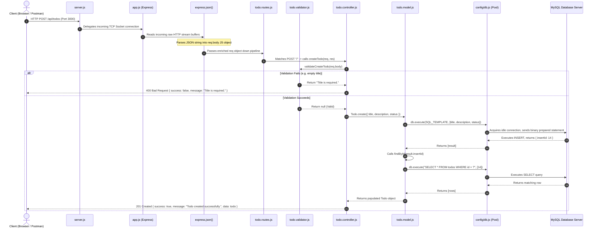

# 01. Architecture & End-to-End Request Flow

---

## 1. High-Level Architectural Pattern

The application follows the **Layered Architecture (3-Tier / MVC Pattern)**, which separates responsibilities cleanly into independent layers:

```
┌────────────────────────────────────────────────────────┐
│                   Presentation Layer                   │
│   • EJS View Templates (index.ejs)                     │
│   • JSON REST API Responses                            │
└──────────────────────────┬─────────────────────────────┘
                           │
┌──────────────────────────▼─────────────────────────────┐
│                    Routing & Transport                  │
│   • server.js (Port Listener, DB Preflight Check)      │
│   • app.js (Express Middleware Pipeline)               │
│   • todo.routes.js (HTTP Method & Path Mapping)        │
└──────────────────────────┬─────────────────────────────┘
                           │
┌──────────────────────────▼─────────────────────────────┐
│                Business & Validation Layer             │
│   • todo.validator.js (Data Contract Verification)     │
│   • todo.controller.js (Orchestration, ID parsing)    │
│   • api-response.js (Standardized Response Envelope)   │
└──────────────────────────┬─────────────────────────────┘
                           │
┌──────────────────────────▼─────────────────────────────┐
│                   Data Access Layer                    │
│   • todo.model.js (SQL Queries, Parameter Binding)     │
│   • config/db.js (MySQL2 Connection Pool)              │
│   • MySQL Database Engine (todos table)                │
└────────────────────────────────────────────────────────┘
```

---

## 2. Real-Life Analogy: The 5-Star Restaurant System

To explain this architecture intuitively in an interview, compare it to a **luxury restaurant**:

| Component in App | Restaurant Analogy | Role & Responsibility |
|---|---|---|
| **Client (Browser / Postman)** | **Customer** | Arrives with a hunger/request ("I want to place an order for a new task"). |
| **`server.js`** | **Security Guard & Main Gate** | Checks if the kitchen power and gas are on (`SELECT 1`). If ready, opens the restaurant doors (`app.listen(PORT)`). |
| **`app.js`** | **Reception & Floor Rules** | Welcomes the guest, applies global dress code, sanitizes bags (`express.json()` parses payload), guides guests to the right section. |
| **`todo.routes.js`** | **Food Menu** | Defines what can be ordered and how (`POST /` = Create food, `GET /:id` = View specific dish). |
| **`todo.validator.js`** | **Order Checker / Waiter Desk** | Validates the order before sending it to the chef: "Is the title blank? Is the status allowed?" Rejects invalid orders immediately before wasting kitchen time. |
| **`todo.controller.js`** | **Head Waiter / Restaurant Manager** | Coordinates the workflow: verifies ID, instructs the kitchen, packages the final dish with a garnish (`api-response.js`), and serves it to the customer. |
| **`todo.model.js`** | **Executive Chef** | Knows how to prepare the exact recipe: writes the SQL queries, binds values securely using tongs/trivets (prepared statements `?`). |
| **`config/db.js` (Pool)** | **Pantry / Refrigerator Keys** | Reusable keys to the stockroom. Instead of making a new key every time someone needs milk, cooks borrow an existing key from a pool rack. |
| **MySQL Database** | **Pantry / Storage Cold Room** | The physical storage where food records actually live permanently on disk. |

---

## 3. End-to-End Request-Response Lifecycle Flow

When a client sends `POST /api/todos` with `{ "title": "Buy Groceries", "description": "Milk and Eggs" }`, here is the exact chronological sequence of events:



---

## 4. Line-by-Line Execution Walkthrough

### Step 1: Network Ingestion
- Client initiates a TCP handshake to `localhost:3000`.
- Node.js `http.Server` (created under the hood by `app.listen` in [`src/server.js`](file:///d:/node_project/todo-app/src/server.js)) emits the `'request'` event.

### Step 2: Express Pipeline Traversal
- In [`src/app.js`](file:///d:/node_project/todo-app/src/app.js):
  - Request hits `express.json()`. If the header `Content-Type: application/json` is present, it buffers the chunks of data, parses JSON, and assigns the resulting JavaScript object to `req.body`.
  - Request passes through `express.urlencoded({ extended: true })`.
  - Request reaches the router mount: `app.use("/api/todos", todoRoutes)`. Express strips the `/api/todos` prefix and forwards the remaining path `/` to [`src/routes/todo.routes.js`](file:///d:/node_project/todo-app/src/routes/todo.routes.js).

### Step 3: Route Dispatching
- The router compares the HTTP Verb `POST` and path `/` with its registered route table.
- It finds `router.post("/", createTodo)`.
- It invokes [`createTodo(req, res)`](file:///d:/node_project/todo-app/src/controllers/todo.controller.js#L12-L26).

### Step 4: Defensive Input Validation
- The controller does not touch the database immediately. It invokes [`validateCreateTodo(req.body)`](file:///d:/node_project/todo-app/src/validators/todo.validator.js#L8-L36).
- If validation fails, it halts immediately (Fail-Fast pattern) and returns HTTP 400.

### Step 5: Business Logic Execution
- The controller cleans input: `title: req.body.title.trim()`.
- It delegates persistence to [`Todo.create(...)`](file:///d:/node_project/todo-app/src/models/todo.model.js#L3-L12).

### Step 6: Database Persistence
- The model uses the connection pool from [`src/config/db.js`](file:///d:/node_project/todo-app/src/config/db.js).
- `db.execute()` uses MySQL binary prepared statements. Placeholder `?` parameters are sent separately from the SQL command to eliminate SQL Injection.
- The database inserts the record, assigns an auto-incrementing ID, and records `created_at` and `updated_at` via `NOW()`.

### Step 7: Response Formatting
- The controller retrieves the freshly inserted row via `findById(insertId)`.
- The controller invokes [`response.success(res, "Todo created successfully.", todo, 201)`](file:///d:/node_project/todo-app/src/utils/api-response.js#L1-L7).
- A consistent JSON structure is sent with status `201 Created`.

---

## 5. Architectural Principles Applied

1. **Separation of Concerns (SoC)**:
   - Routing knows *where* to direct.
   - Controllers know *what* workflow to execute.
   - Validators know *what data* is permissible.
   - Models know *how* to talk to the SQL engine.
   - Views know *how to display* information.

2. **Single Responsibility Principle (SRP)**:
   - Each file has exactly one reason to change. If the database schema changes, only `todo.model.js` is touched. If API URL patterns change, only `todo.routes.js` is touched.

3. **Fail-Fast Principle**:
   - Bad inputs are rejected at the validator layer before wasting CPU cycles, memory, or database connection pool slots.

4. **Defense in Depth**:
   - Double validation occurs: validator checks types/lengths, controller checks safe integers (`parseId`), model enforces parameter binding (`?`), and MySQL enforces column constraints (`NOT NULL`, `ENUM`).

---

## 6. Interview Questions & Model Answers

### Q1: Why did you separate `server.js` from `app.js`?
> **Answer**: Separating `app.js` from `server.js` isolates Express application configuration from network server provisioning. 
> - `app.js` declares routes, middlewares, view engines, and error handlers without binding to a network port.
> - `server.js` imports `app.js`, performs pre-flight environment checks (like `SELECT 1` on MySQL), and calls `app.listen()`.
> **Primary benefit**: In integration testing using libraries like `Supertest`, you can import `app` directly without starting a live HTTP server on a real port, preventing port collisions and speeding up CI/CD test runs.

### Q2: What is the middleware pipeline order and why does it matter?
> **Answer**: Express executes middlewares sequentially in the order they are mounted with `app.use()`. 
> 1. Body parsers (`express.json()`) must come *before* routes, otherwise `req.body` will be `undefined` inside route handlers.
> 2. Routes are declared next.
> 3. The 404 handler must come *after* all valid routes so it acts as a catch-all.
> 4. The global error handler (`(err, req, res, next)`) must be placed *dead last* so any unhandled exceptions in prior middlewares bubble down into it.

### Q3: What is the difference between Layered Architecture and MVC?
> **Answer**: MVC (Model-View-Controller) is a presentation-oriented pattern. Layered Architecture (N-Tier) divides the application horizontally by technical responsibilities (Presentation -> Business Logic -> Data Access). In this project, they blend harmoniously:
> - **View**: EJS template (`index.ejs`).
> - **Controller**: Express route handlers (`todo.controller.js`).
> - **Model**: Data query modules (`todo.model.js`).
> - **Data Layer**: MySQL2 Pool connection (`db.js`).
