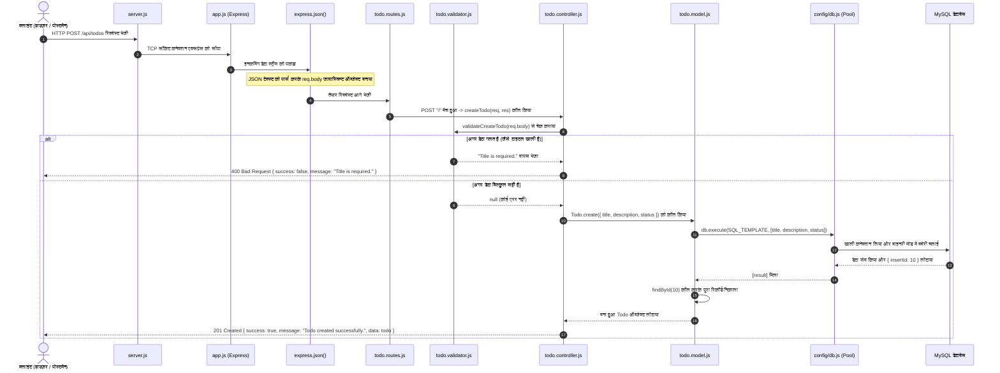

# 01. आर्किटेक्चर और कम्पलीट रिक्वेस्ट फ्लो (Architecture & Request Flow)

---

## 1. प्रोजेक्ट का हाई-लेवल आर्किटेक्चर

हमारा यह Todo प्रोजेक्ट **लेयर्ड आर्किटेक्चर (3-Tier / MVC Pattern)** पर बना हुआ है। इसमें हर लेयर की अपनी एक तय ज़िम्मेदारी (Separation of Concerns) होती है:

```text
┌────────────────────────────────────────────────────────┐
│               प्रेजेंटेशन लेयर (Presentation Layer)      │
│   • EJS व्यू टेम्पलेट्स (index.ejs - HTML/UI)           │
│   • JSON REST API रिस्पांस ({ success, message, data })│
└──────────────────────────┬─────────────────────────────┘
                           │
┌──────────────────────────▼─────────────────────────────┐
│             ट्रांसपोर्ट और रूटिंग लेयर (Routing Layer)   │
│   • server.js (पोर्ट चालू करना, DB हेल्थ चेक)         │
│   • app.js (एक्सप्रेस मिडलवेयर पाइपलाइन)                │
│   • todo.routes.js (HTTP मेथड्स और पाथ की मैपिंग)      │
└──────────────────────────┬─────────────────────────────┘
                           │
┌──────────────────────────▼─────────────────────────────┐
│          बिज़नेस और वैलिडेशन लेयर (Business & Validation)│
│   • todo.validator.js (डेटा सही है या नहीं चेक करना)   │
│   • todo.controller.js (ID पार्सिंग, काम करवाना)       │
│   • api-response.js (एक जैसा रिस्पांस फॉर्मेट बनाना)    │
└──────────────────────────┬─────────────────────────────┘
                           │
┌──────────────────────────▼─────────────────────────────┐
│             डेटा एक्सेस लेयर (Data Access Layer)         │
│   • todo.model.js (SQL क्वेरीज़, पैरामीटर बाइंडिंग)      │
│   • config/db.js (MySQL2 कनेक्शन पूल)                 │
│   • MySQL डेटाबेस इंजन (todos टेबल)                    │
└────────────────────────────────────────────────────────┘
```

---

## 2. रियल-लाइफ उदाहरण: 5-स्टार रेस्टोरेंट का सिस्टम

इंटरव्यू में जब आपसे पूछा जाए कि यह पूरा फ्लो कैसे काम करता है, तो आप इस **5-स्टार रेस्टोरेंट** के उदाहरण से समझाइए:

| कोड कंपोनेंट | रेस्टोरेंट का किरदार | असल काम (जिम्मेदारी) |
|---|---|---|
| **क्लाइंट (Browser / Postman)** | **ग्राहक (Customer)** | रेस्टोरेंट में आकर नया आर्डर देना चाहता है ("मुझे एक नया टास्क बनाना है")। |
| **`server.js`** | **गेटकीपर / सुरक्षा गार्ड** | चेक करता है कि किचन में बिजली-पानी चालू है या नहीं (`SELECT 1`)। सब ठीक है, तभी रेस्टोरेंट का मेन गेट खोलता है (`app.listen`)। |
| **`app.js`** | **रिसेप्शन और चेकिंग डेस्क** | ग्राहक का स्वागत करता है, बैग चेक करता है और पार्स करता है (`express.json()`), और सही हॉल की तरफ भेजता है। |
| **`todo.routes.js`** | **खाने का मेनू कार्ड** | तय करता है कि ग्राहक क्या मांग सकता है (`POST /` = नया खाना, `GET /:id` = पुराना खाना देखना)। |
| **`todo.validator.js`** | **आर्डर चेकर वेटर** | शेफ के पास जाने से पहले पर्ची चेक करता है: "क्या डिश का नाम खाली तो नहीं? क्या स्टेटस सही लिखा है?" अगर गलत है तो ग्राहक को तुरंत वापस भेज देता है (Fail-Fast)। |
| **`todo.controller.js`** | **हेड वेटर / मैनेजर** | पूरे काम को मैनेज करता है: टेबल नंबर (ID) चेक करता है, किचन को आर्डर देता है, तैयार डिश को सुंदर प्लेट में सजाता है (`api-response.js`) और ग्राहक को सर्व करता है। |
| **`todo.model.js`** | **चीफ शेफ (रसोइया)** | असली रेसिपी जानता है: सुरक्षित तरीके से चिमटे से मसाले मिलाता है (Prepared Statements `?`) ताकि कोई ज़हर (SQL Injection) न मिला सके। |
| **`config/db.js` (Pool)** | **स्टोर रूम की चाबियों का हैंगर** | बार-बार नई चाबी बनाने की बजाय 10 रेडीमेड चाबियां (कनेक्शन पूल) रखता है। शेफ चाबी लेता है, सामान लाता है, चाबी वापस टांग देता है। |
| **MySQL डेटाबेस** | **कोल्ड स्टोरेज / गोदाम** | जहाँ सारा कच्चा माल (डाटा) हमेशा के लिए हार्ड ड्राइव पर सुरक्षित रहता है। |

---

## 3. रिक्वेस्ट का पूरा सफर (End-to-End Sequence Diagram)

जब आप ब्राउज़र से `POST /api/todos` पर `{ "title": "किताब पढ़ना" }` भेजते हैं, तो बैकएंड में क्या होता है:



---

## 4. कोड फ्लो स्टेप-बाय-स्टेप (Line by Line)

1. **क्लाइंट रिक्वेस्ट**: यूज़र ने बटन दबाया। नेटवर्क पैकेट पोर्ट `3000` पर पहुंचा।
2. **`server.js`**: पोर्ट `3000` पर लिस्नर एक्टिव था। उसने रिक्वेस्ट को `app.js` को दे दिया।
3. **`app.js` का `express.json()`**: इसने देखा कि हेडर में `Content-Type: application/json` है। इसने बाइट्स को जोड़कर `req.body` ऑब्जेक्ट बना दिया।
4. **रूट मैचिंग**: एक्सप्रेस ने देखा कि URL में `/api/todos` है, तो उसने इसे `todo.routes.js` को सौंप दिया। वहां `POST /` मैच हुआ और `createTodo` कंट्रोलर शुरू हुआ।
5. **वैलिडेशन**: कंट्रोलर ने सीधे डाटाबेस को हाथ नहीं लगाया। पहले `validateCreateTodo(req.body)` को दिया। अगर कोई गड़बड़ थी, तो तुरंत 400 एरर दे दिया (Fail-Fast)।
6. **कंट्रोलर और ट्रिमिंग**: इनपुट के फालतू स्पेस हटाए (`title.trim()`), फिर मॉडल को बोला कि इसे सेव करो।
7. **मॉडल और MySQL पूल**: मॉडल ने `config/db.js` के पूल से कनेक्शन मांगा और `db.execute()` चलाया। `?` का इस्तेमाल होने की वजह से हैकर कोई SQL इंजेक्शन नहीं कर पाया।
8. **रिस्पांस डिलीवरी**: नया बना हुआ रिकॉर्ड `findById` से निकाला गया और `api-response.js` के `success()` फंक्शन से एक शानदार JSON बना कर यूज़र को भेज दिया गया।

---

## 5. इंटरव्यू में पूछे जाने वाले महत्वपूर्ण सवाल (FAQ)

### प्र. 1: आपने `server.js` और `app.js` को अलग-अलग फाइलों में क्यों रखा?
> **सटीक उत्तर**: 
> "सर, हमने `app.js` और `server.js` को अलग-अलग इसलिए रखा ताकि हमारा कोड **मॉड्यूलर** रहे और हम **ऑटोमेटेड टेस्टिंग (Integration Testing)** आसानी से कर सकें।
> - `app.js` में सिर्फ एक्सप्रेस का सेटअप (मिडलवेयर, रूट्स, एरर हैंडलर) होता है, वहां सर्वर चालू (`app.listen`) नहीं होता।
> - जब हम Supertest या Jest से टेस्ट केस लिखते हैं, तो हम सीधे `app.js` को इम्पोर्ट कर लेते हैं। टेस्ट लाइब्रेरी बिना किसी रियल पोर्ट को घेरे मेमोरी में ही टेस्ट चला लेती है। अगर `app.listen()` उसी फाइल में होता, तो टेस्टिंग के वक्त `EADDRINUSE` (Port already in use) की एरर आ जाती।"

### प्र. 2: Fail-Fast सिद्धांत (Principle) क्या होता है और यह हमारे प्रोजेक्ट में कहाँ इस्तेमाल हुआ है?
> **सटीक उत्तर**:
> "Fail-Fast का मतलब है कि अगर इनपुट में कोई भी गलती है, तो उसे सिस्टम की बाउंड्री पर ही तुरंत रोक दो, बजाय इसके कि वह कोड अंदर जाकर डेटाबेस या सीपीयू का समय बर्बाद करे।
> हमारे प्रोजेक्ट में यह `todo.validator.js` में इस्तेमाल हुआ है। अगर यूज़र ने खाली टाइटल या गलत स्टेटस भेजा है, तो हम डेटाबेस क्वेरी चलाए बिना ही उसे पहले स्टेप पर 400 Bad Request लौटा देते हैं।"
